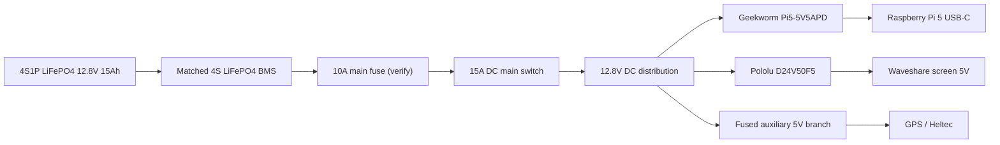

# Wiring and power design

This is the selected V1 power direction. The battery pack is not ordered. Check the final cell and BMS datasheets before connecting anything.

## Selected power system

- Battery: supplier-built 4S1P LiFePO4 pack, four 3.2 V 15 Ah Gotion 33140 cells, 12.8 V nominal, 15 Ah, 192 Wh.
- BMS: matched 4S LiFePO4 BMS supplied with the pack, with balancing, temperature sensing and low-temperature charge cut-off.
- Main fuse: 10 A automotive blade fuse close to battery positive. This is a starting value, not final approval. Verify it against peak current, cable ampacity and converter requirements.
- Main switch: DC rated, at least 15 A at 16 V DC.
- Pi supply: Geekworm Pi5-5V5APD, 9–24 V input, USB-C 5 V/5 A PD output. The terminal-block version still needs to be confirmed as an actual orderable product; the Geekworm page I found shows the DC-jack version.
- Screen supply: Pololu D24V50F5, 6–38 V input, 5 V output. Mount it so it can cool.
- GPS and main Heltec: powered from Pi USB or a separately fused 5 V branch, depending on final board versions. Do not power them from GPIO pins.
- Handheld: separate battery as already planned.

## Power flow

## Main wiring

| From | To | Notes |
|---|---|---|
| Battery positive | BMS B+ | Pack builder supplies and verifies cell wiring |
| Battery negative | BMS B- | Pack builder supplies and verifies cell wiring |
| BMS P+ / P- | Main fuse and system output | Follow the exact BMS manual |
| Main fuse | Main switch | Fuse close to battery positive |
| Main switch | 12.8 V distribution | Use covered terminal block |
| 12.8 V bus | Geekworm input | Confirm polarity with a meter first |
| Geekworm USB-C | Pi 5 USB-C | Short, good USB-C cable |
| 12.8 V bus | Pololu VIN | Check board polarity |
| Pololu 5 V output | Screen 5 V input | Check screen connector and polarity |

## Geekworm Pi supply

According to the Geekworm wiki, on the 9–24 V version shorting the jumper raises the output by about 0.2 V. On the 9–15 V version, removing the jumper raises it instead. I need to confirm which exact board version I can buy.

My initial test plan is to start without the jumper and measure voltage at the Pi under load. I can read the Pi's voltage using `vcgencmd pmic_read_adc` and check `EXT5V_V`. I should use a short, thick USB-C cable.

The Pi must report a 5 A power supply; otherwise its USB current is limited. The module has its own fan. I still need to confirm that the terminal-block variant exists and is orderable, because the Geekworm page I found shows the DC-jack version.

## Screen 5 V and USB touch

The Pololu converter supplies 5 V to the screen. The Pi USB cable is also connected for touch data. I need to check whether the screen connects the USB 5 V line to its own 5 V input. The two 5 V sources must not be connected together. If they are connected, I should use a data-only USB cable.

## Wire and connector starting points

For short internal battery-to-bus wiring, use flexible copper wire with crimped terminals and strain relief. Final wire size must be checked against length, temperature, bundling and fuse. Use locking connectors or covered screw terminals. Do not use Dupont jumpers for power.

## Charge input (to decide)

The charger should connect through its own fused, keyed connector with reverse-polarity protection. It must not connect through the main switch or the switched system bus. Charging should not depend on the main switch, and the charger should not see the system load.

The wall charger and car charger must not be connected at the same time. The exact connector, fuse, reverse-polarity protection and wiring are still an open design question. Both chargers stay outside the case. No 230 V mains wiring goes inside OFFGRID.

## Safe shutdown (to decide)

The BMS will cut power hard if the battery voltage gets too low. This can corrupt the SSD if the Pi is still writing data.

One idea is to add a power monitor, for example an INA226 over I2C, to measure battery voltage and current. The Pi could use this information to start a soft shutdown before the BMS cuts power.

LiFePO4 voltage is a poor state-of-charge indicator, so I cannot choose a reliable shutdown threshold from voltage alone yet. The threshold and shutdown method are still to decide after testing.

## KiCad

The KiCad file is only a planning drawing; I still need to draw the real schematic and run ERC/DRC before any PCB.

The PCB should be a low-voltage distribution/carrier board for the bought converter modules, fuse, switch and connectors. It should not contain a home-designed high-current switching regulator. Do not build hardware from the planning drawing alone.
