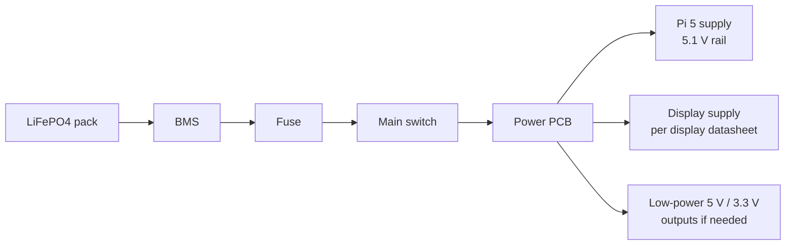

# OFFGRID – electrical design (first draft)

This is my first wiring plan for OFFGRID. It is not the final circuit yet. I still need to choose the exact battery and power modules, then check their datasheets before making the PCB.

## 1. Main power path

The battery voltage is not fixed in this document yet. The battery, BMS and charger must be selected as one compatible set. The fuse, wire size, switch rating and converter ratings depend on the final battery and measured loads.

The Pi 5 needs a stable 5.1 V supply with enough current for the Pi, SSD and USB devices. The screen needs a separate supply sized from the exact Waveshare display datasheet. The grounds must be connected together where the data interfaces require a common reference.

## 2. Main station signal connections

| Module | Connection | Notes |
|---|---|---|
| Pi 5 | 512 GB NVMe SSD | Through the official M.2 HAT+ |
| Pi 5 | 8-inch screen | HDMI for video, USB for touch |
| Pi 5 | u-blox M10 GNSS | UART or USB, final interface to confirm |
| Pi 5 | Heltec LoRa 32 V3 | UART connection, exact pins still to confirm |
| Power PCB | Pi 5 | Regulated 5.1 V supply |
| Power PCB | Main screen | Supply voltage/current to be confirmed from exact display version |

## 3. Handheld signal connections

The handheld uses a Waveshare ESP32-S3 touchscreen board and a separate Heltec LoRa 32 V3 board.

| Waveshare ESP32-S3 | Heltec V3 | Purpose |
|---|---|---|
| TX GPIO43 | RX GPIO48 | UART data to LoRa board |
| RX GPIO44 | TX GPIO47 | UART data from LoRa board |
| GND | GND | Common ground |

These are the planned UART pins from the current parts notes. I need to verify the labels on the actual board revisions before soldering. Both boards use 3.3 V logic. Do not connect a 5 V UART signal to these GPIO pins.

The handheld battery and charging circuit still need to be selected. It will be a separate power system from the main LiFePO4 pack.

## 4. Things to check before making the PCB

- Confirm the exact LiFePO4 pack voltage, capacity, BMS current rating and charger.
- Check the Pi 5 maximum input current and select a converter that can handle its peaks.
- Check the exact screen's input voltage and current.
- Add a fuse close to the battery and choose the fuse and wire sizes from the real maximum current.
- Add reverse-polarity and short-circuit protection.
- Decide how battery voltage/current will be measured.
- Decide how the Pi will shut down safely when the battery is low.
- Check every connector pinout against the manufacturer's documentation.
- Run ERC in KiCad and review the schematic before starting PCB layout.

## 5. Not included in this first draft

- Solar charging
- RTL-SDR
- Separate GPS trackers
- Tracker location history

Those are not part of the first version.

**Status:** first wiring plan only. Do not build the power PCB or connect the battery based only on this draft. The missing electrical ratings must be filled in after the exact battery, screen and converters are selected.
