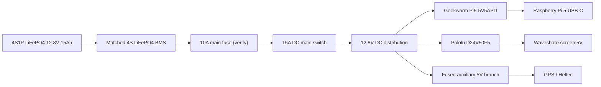

# Wiring and power design

This is the selected V1 power direction. The battery pack is not ordered. Check the final cell and BMS datasheets before connecting anything.

## Selected power system

- Battery: supplier-built 4S1P LiFePO4 pack, four 3.2 V 15 Ah Gotion 33140 cells, 12.8 V nominal, 15 Ah, 192 Wh.
- BMS: matched 4S LiFePO4 BMS supplied with the pack, with balancing, temperature sensing and low-temperature charge cut-off.
- Main fuse: 10 A automotive blade fuse close to battery positive. This is a starting value, not final approval. Verify it against measured peak current, cable ampacity and converter requirements.
- Main switch: DC rated, at least 15 A at 16 V DC.
- Pi supply: Geekworm Pi5-5V5APD terminal-block version, 9–24 V input, USB-C 5 V/5 A PD output. Check voltage at the Pi under full load.
- Screen supply: Pololu D24V50F5, 6–38 V input, 5 V output. Mount it so it can cool.
- GPS and main Heltec: powered from Pi USB or a separately fused 5 V branch, depending on final board versions. Do not power them from GPIO pins.
- Handheld: separate battery as already planned.

## Power flow

## Main wiring

| From | To | Notes |
|---|---|---|
| Battery positive | BMS B+ | Pack builder supplies and verifies cell wiring |
| Battery negative | BMS B- | Pack builder supplies and verifies cell wiring |
| BMS P+ / P- | Main fuse and system output | Follow the exact BMS manual |
| Main fuse | Main switch | Fuse close to battery positive |
| Main switch | 12.8 V distribution | Use covered terminal block |
| 12.8 V bus | Geekworm input | Confirm polarity with a meter first |
| Geekworm USB-C | Pi 5 USB-C | Short, good USB-C cable |
| 12.8 V bus | Pololu VIN | Check board polarity |
| Pololu 5 V output | Screen 5 V input | Check screen connector and polarity |

## Wire and connector starting points

For short internal battery-to-bus wiring, use flexible copper wire with crimped terminals and strain relief. Final wire size must be checked against length, temperature, bundling and fuse. Use locking connectors or covered screw terminals. Do not use Dupont jumpers for power.

## Charging

Use an external LiFePO4 charger. The exact voltage and current must be approved by the pack supplier. Do not assume the previous 14.2 V charger setting is correct for these cells.

For car charging, use a programmable DC-DC charger and configure it only after the pack supplier confirms the charge profile. Both chargers stay outside the case. No 230 V wiring goes inside the case.

## KiCad status

The current KiCad drawing is only a planning diagram. A proper schematic and PCB still need to be made and checked. The PCB should be a low-voltage distribution/carrier board for the bought converter modules, fuse, switch and connectors. It should not contain a home-designed high-current switching regulator.

I can prepare the KiCad source files in this GitHub repository. I do not have a live desktop session to open KiCad and run ERC/DRC here. Before a PCB is released for manufacture, its footprints, clearances, track widths, mounting holes and connector models must be checked in KiCad.

Do not build hardware from the planning drawing alone.
