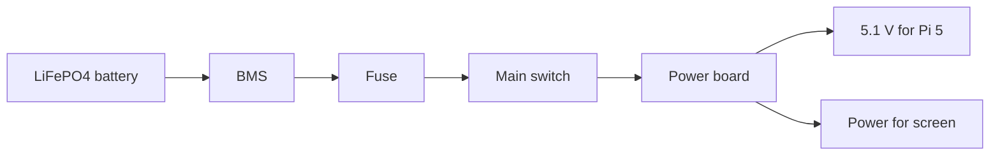

# Wiring notes

This is my first idea for the wiring. It is not finished yet because I still need to choose the battery and power parts.

## Power

The battery voltage is not decided yet. I need to choose the battery, BMS and charger so they work together.

The Pi needs a stable 5.1 V supply with enough current. The screen needs the voltage and current written in its datasheet. I will choose the converters after checking these things.

## Main station connections

| Part | Connection |
|---|---|
| Pi 5 to SSD | M.2 HAT+ |
| Pi 5 to screen | HDMI for picture, USB for touch |
| Pi 5 to GPS | UART or USB, not decided |
| Pi 5 to Heltec | UART, pins not decided |
| Power board to Pi | 5.1 V supply |
| Power board to screen | Supply to be checked |

## Handheld connections

The handheld has a Waveshare ESP32-S3 screen and a separate Heltec LoRa board.

| Waveshare | Heltec | What it does |
|---|---|---|
| GPIO43 TX | GPIO48 RX | Sends data |
| GPIO44 RX | GPIO47 TX | Receives data |
| GND | GND | Common ground |

These are the pins I plan to use. I need to check the exact board versions before soldering. Do not connect 5 V to these GPIO pins.

## Before I make the PCB

- Pick the battery and check its BMS.
- Pick a charger that matches the battery.
- Choose converters for the Pi and screen.
- Work out fuse and wire sizes from the actual current.
- Check connector pinouts.
- Draw the final circuit in KiCad and run ERC.

**Important:** This is not a finished circuit. I should not connect the battery or make the power PCB using only these notes. The missing values need to be checked first.
