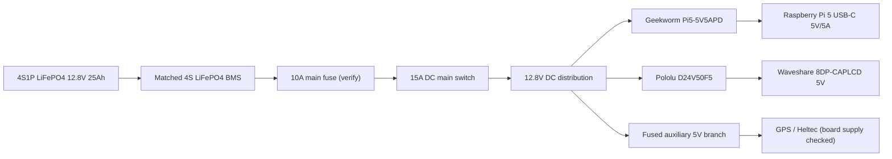

# Wiring and power design

This is the selected V1 power architecture. The battery pack is still a supplier order, so check its final datasheet before connecting anything.

## Selected power system

- Battery: supplier-made 4S1P LiFePO4 pouch pack, 12.8 V nominal, 25 Ah, 320 Wh.
- BMS: matched 4S LiFePO4 BMS supplied with the pack, with balancing, temperature sensing and low-temperature charge cut-off.
- Main fuse: 10 A automotive blade fuse close to battery positive. This is a starting value for the planned load, not a final approval; check it against measured peak current, cable ampacity and converter input requirements before fitting.
- Main switch: DC rated, at least 15 A at 16 V DC.
- Pi supply: Geekworm Pi5-5V5APD, terminal-block input version, 9–24 V input, USB-C 5 V/5 A PD output. Input power must be over 30 W for full output. Use a short, good USB-C cable.
- Screen supply: Pololu D24V50F5, 6–38 V input, 5 V output, up to 5 A typical. The screen uses about 4 W, so this has margin. Mount it so it can cool.
- GPS and main Heltec: powered from Pi USB or a separately fused 5 V branch, depending on the final board versions. Do not power them from GPIO pins.
- Handheld: separate battery as already planned.

Product references:
- Geekworm Pi5-5V5APD: https://wiki.geekworm.com/Pi5-5V5APD
- Pololu D24V50F5: https://www.pololu.com/product/2851/specs

## Power flow

## Main wiring

| From | To | Notes |
|---|---|---|
| Battery positive | BMS B+ | Pack builder supplies and verifies cell wiring |
| Battery negative | BMS B- | Pack builder supplies and verifies cell wiring |
| BMS P+ / P- | Main fuse and system output | Follow the exact BMS manual |
| Main fuse | Main switch | Fuse close to battery positive |
| Main switch | 12.8 V distribution | Use covered terminal block |
| 12.8 V bus | Geekworm input | Confirm polarity with a meter first |
| Geekworm USB-C | Pi 5 USB-C | Short 5 A-capable cable |
| 12.8 V bus | Pololu VIN | Check board polarity |
| Pololu 5 V output | Screen 5 V input | Check screen connector and polarity |
| 12.8 V bus | Auxiliary 5 V converter | Add a small branch fuse after load is measured |

## Wire and connector starting points

For the short internal battery-to-bus wiring, use flexible copper wire at least 1.5 mm² with crimped terminals and proper strain relief. The final wire size must be checked against length, temperature, bundling and fuse. Use locking connectors or covered screw terminals. Do not use Dupont jumpers for power.

## Charging

- Wall: external 4S LiFePO4 charger, initially target 5 A, matched to the final cell/BMS charge voltage.
- Car: a proper automotive DC-DC battery charger configured for 4S LiFePO4, with engine detection and current limit. I choose a Victron Orion-Tr Smart model only after matching the input/output voltage and power variant to the car and pack.
- No 230 V inside the case.
- No direct connection to the car socket or alternator.

## KiCad status

The KiCad project is a wiring-level planning drawing. It is not yet a PCB layout. The converters are complete modules, so I plan to mount them on a small carrier/distribution PCB with screw terminals, fuse holder, switch connection and labelled output connectors. This avoids designing a high-current switching converter from scratch.

Before the PCB can be released, I still need the actual battery connector, fuse holder, terminal blocks and mechanical measurements. Do not fabricate the board from placeholder footprints.
