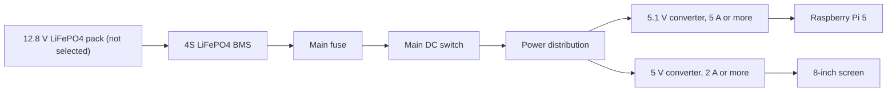

# Wiring notes

This is the current idea for the wiring. It is still not a finished circuit. I need to choose the battery and exact converters before making the final KiCad schematic.

## Power idea

I am looking at a 4S LiFePO4 battery (12.8 V nominal). A 20 Ah pack is the first size to investigate, but it must fit the case.

The voltage and current values above are design targets, not selected parts.

## Why separate converters?

The Pi 5 can need a 5 V, 5 A supply to support the board and USB devices. The screen is listed at about 4 W. I want separate converters so a load change on the screen does not cause the Pi to reboot.

The Pi converter should be rated for at least 5 A continuous at 5.1 V, with enough cooling. The screen converter should provide 5 V and at least 2 A. I need to check the real current and startup peaks before buying.

## Main station connections

| Part | Connection |
|---|---|
| Pi 5 to SSD | M.2 HAT+ |
| Pi 5 to screen | HDMI for picture, USB for touch |
| Pi 5 to GPS | UART or USB, not decided |
| Pi 5 to Heltec | UART, pins not decided |
| Battery to BMS | Battery pack wiring, must match the pack |
| BMS to fuse and switch | DC power path |
| Power distribution to Pi | 5.1 V converter |
| Power distribution to screen | Separate 5 V converter |

## Handheld connections

The handheld has a Waveshare ESP32-S3 screen and a separate Heltec LoRa board. It will have its own battery.

| Waveshare | Heltec | What it does |
|---|---|---|
| GPIO43 TX | GPIO48 RX | Sends data |
| GPIO44 RX | GPIO47 TX | Receives data |
| GND | GND | Common ground |

These are the pins I plan to use. I need to check the exact board versions before soldering. Do not connect 5 V to these GPIO pins.

## Charging

- Wall charging: external charger for the selected 4S LiFePO4 pack.
- Car charging: automotive DC-DC charger with a LiFePO4 profile.
- No 230 V mains wiring inside the case.
- Do not connect a car socket directly to the battery.

The charger voltage and current must follow the battery manufacturer's instructions.

## Before making a PCB

- Pick the exact battery and check its BMS.
- Pick a charger that matches the battery.
- Choose converters and read their datasheets.
- Work out fuse and wire sizes from the real current and cable length.
- Check connector pinouts and polarity.
- Check the converter temperature at full load.
- Draw the final circuit in KiCad and run ERC.

**Important:** This is not a finished circuit. Do not connect the battery or make a power PCB using only these notes. The missing parts and ratings need to be checked first.
