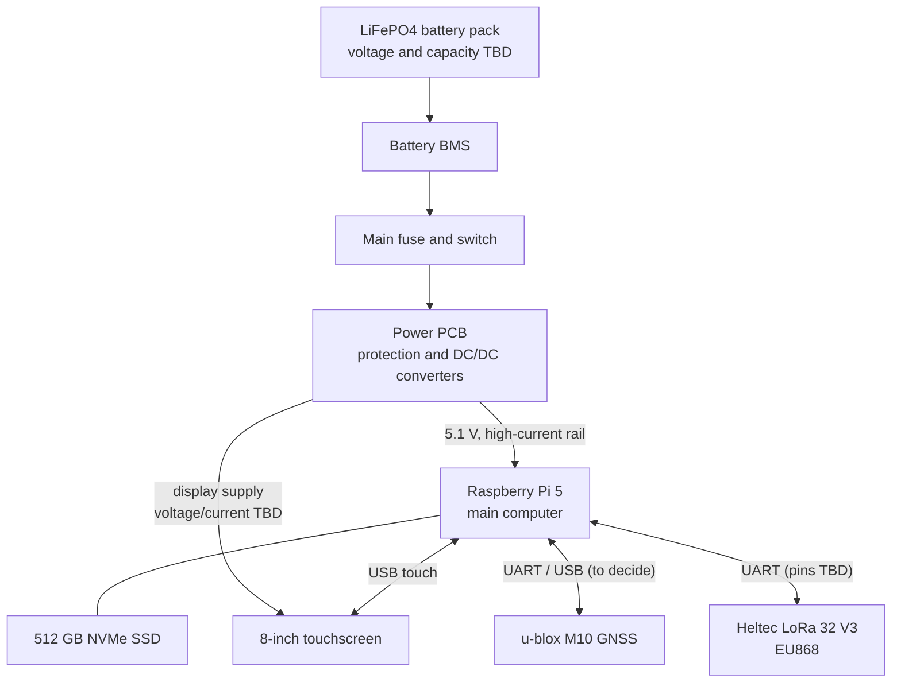
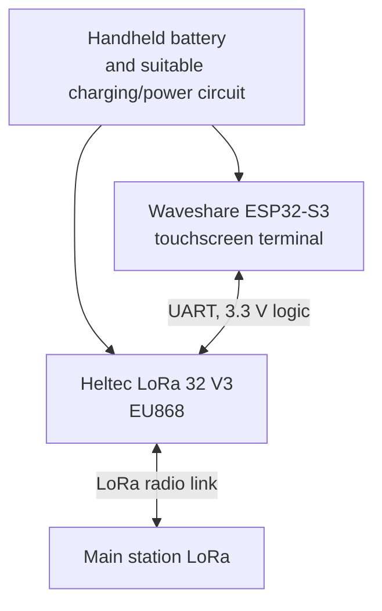

# OFFGRID – system block diagram

This is the first version of the system layout. It shows the main parts and how data and power should move between them. Some exact modules and connectors are still to be chosen.

## Main station

## Handheld terminal

## What it does

- The Raspberry Pi is the main computer. It runs the offline maps, local document search and local AI.
- The GPS module provides the position of the station.
- The main LoRa board sends and receives text messages with the handheld terminal.
- The handheld has its own screen and controls. It does not need a phone or internet connection.
- Separate GPS trackers and RTL-SDR are not part of V1. They may be added in a later version.

## Still to decide

- Exact LiFePO4 battery voltage, capacity, BMS and physical dimensions.
- The DC/DC converter or power module for the Pi 5.
- The correct supply for the 8-inch screen.
- Exact UART pins and connector types for the LoRa and GPS boards.
- The handheld battery and charging circuit.

This is a system diagram, not a finished wiring plan. The exact electrical connections will be checked in the next document and then drawn in KiCad.
