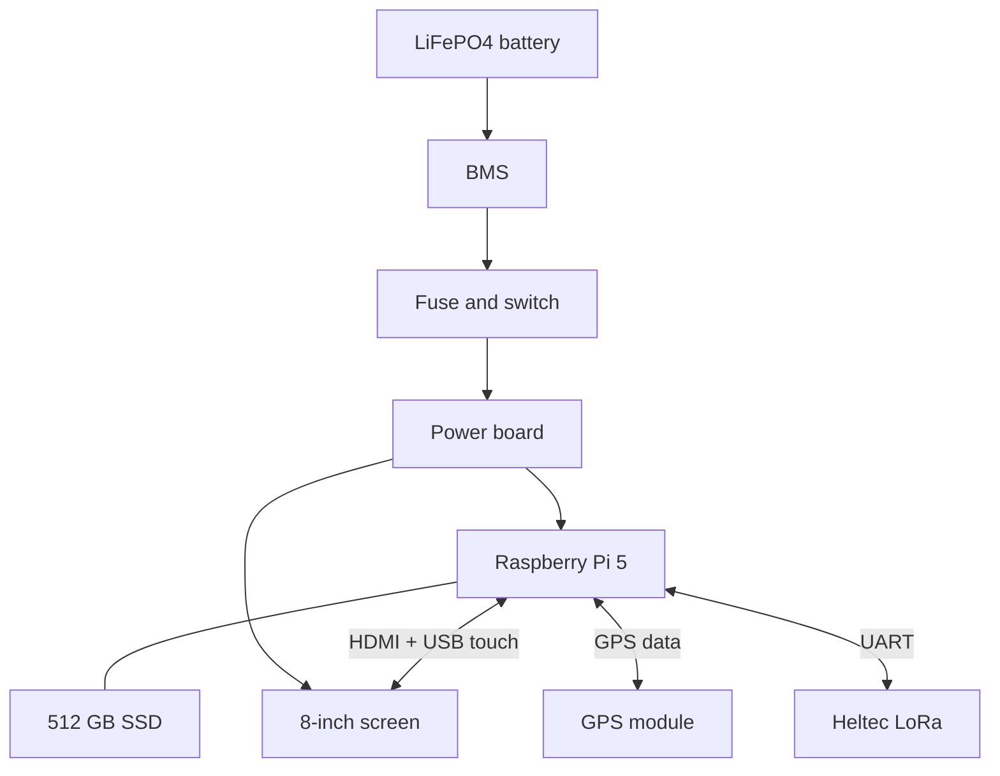
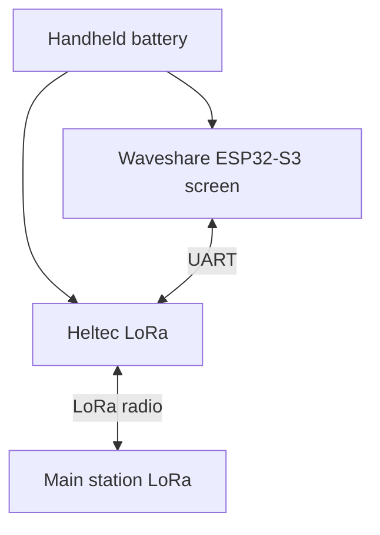

# How the parts connect

This is a simple drawing of how I think the system will work. Some parts are still not chosen.

## Main station

## Handheld

## What it should do

- The Pi is the main computer.
- GPS gives the station its position.
- LoRa is for sending text messages to the handheld.
- The handheld has its own screen and buttons.
- Offline maps, files and local AI should run on the Pi.

RTL-SDR and separate GPS trackers are not part of the first version.

## Not decided yet

- Exact battery and BMS
- Power converters
- Screen power supply
- Exact pins and connectors

This is only the basic plan, not the final wiring. I still need to draw the real circuit in KiCad.
