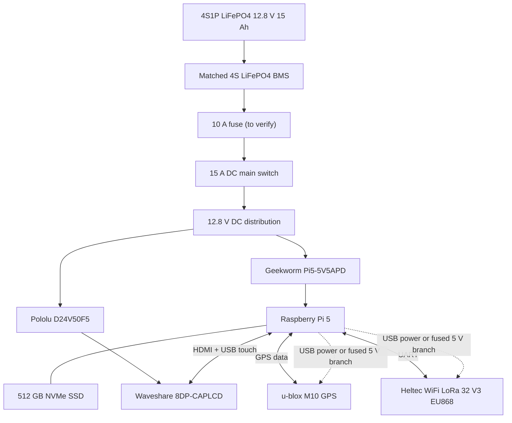
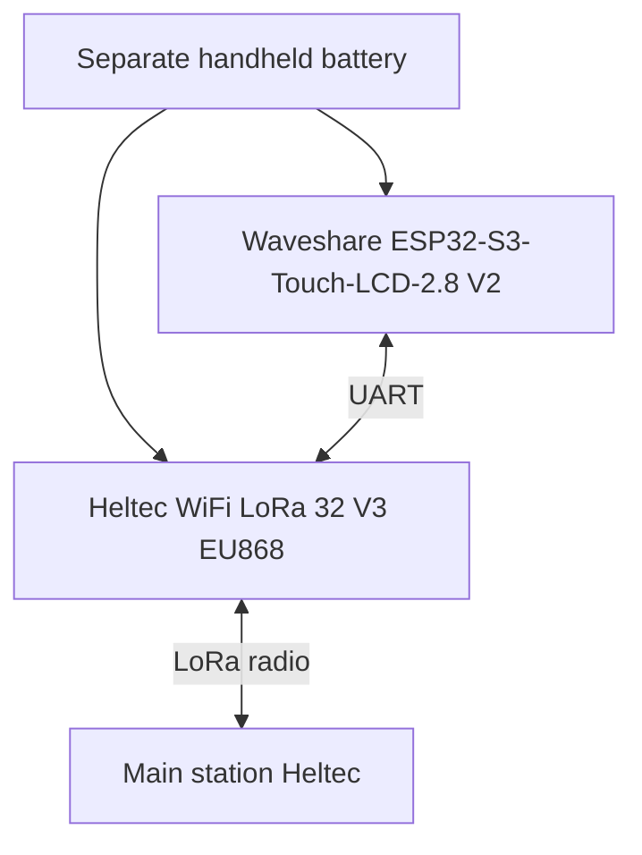

# How the parts connect

This is the current V1 system plan. The exact battery pack, BMS and some connections still need confirmation.

## Main station

The screen gets its 5 V supply from the Pololu converter. The Pi gets power from the Geekworm module. I still need to check that the screen's USB touch connection does not join the Pi's 5 V line to the Pololu 5 V output.

## Handheld

## What it should do

- The Pi is the main computer.
- GPS gives the station its position.
- LoRa is for sending text messages to the handheld.
- The handheld has its own battery.
- Offline maps, files and local AI should run on the Pi.
- RTL-SDR and separate GPS trackers are not part of the first version.

## Not decided yet

- Exact supplier-built battery pack, BMS and battery connector
- Wall and car chargers, including charge input connector and protection
- Exact GPS breakout board
- UART pins
- Final case layout

This is only the basic plan, not the final wiring. I still need to draw the real circuit in KiCad and run ERC/DRC before making a PCB.
